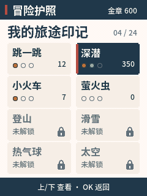
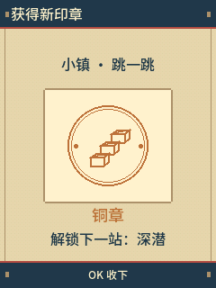
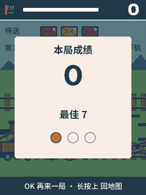

# NABO 的冒险之旅

FoloToy AI Passport（ESP32-C3 / 8 MB）上的 NABO 游戏合集，独立离线固件：开机进入一张竖向冒险地图，从深海一路到太空，8 个游戏站点，每个游戏三枚印章，盖满一本冒险护照。不需要配网、激活或小智服务。

> **开发中。** 11轮美术与共用界面已交付；557607…镜像的新字体、开机和睡醒已获用户真机确认。现在进行正式玩法开发：小火车POST已接入真实规则/美术，173项宿主门禁通过，正在优化帧率并做新候选真机验证；其余五站仍是占位。具体边界见[开发进度](docs/DEVELOPMENT_PROGRESS.md)及[验证记录](docs/VALIDATION.md)，不把美术完成当成正式游戏完成。

| 封面 | 地图 | 护照 | 盖章 | 游戏标题 | 结算 |
|---|---|---|---|---|---|
|  |  |  |  |  |  |

截图由生产C代码在宿主机渲染；共用页面与POST使用正式美术。宿主截图不能代替实体操作、声音和帧率验收。

## 站点

| 站 | 世界 | 游戏 | 状态 |
|---|---|---|---|
| 护照亭 | 小镇 | 冒险护照、设置 | ✅ |
| 1 | 小镇 | 跳一跳：按住蓄力、松开起跳 | ✅ 现成 |
| 2 | 深海 | 深潜：变向、俯冲、氧气 | ✅ 现成 |
| 3 | 铁路平原 | 小火车送信：选轨、卸信、鸣笛 | 正式玩法已接入；真机验证中 |
| 4 | 夜林 | 萤火虫：挪动、举罐抓萤火虫 | 占位 |
| 5 | 雪山 | 登山：换边、蓄力跳、躲落石 | 占位 |
| 6 | 雪坡 | 滑雪：转弯、过旗门 | 占位 |
| 7 | 云端 | 热气球：加热上升、躲鸟群 | 占位 |
| 8 | 太空 | 太空着陆：喷气、倾斜、平稳落地 | 占位 |

上一站拿到铜章，下一站解锁。

## 操作

- 地图：上 / 下 沿路线走，OK 进入，长按 OK 打开护照，长按上回封面。
- 新游戏（统一流程）：OK 开始；进行中长按上暂停；暂停里 OK 继续、下 重来、长按上回地图。
- 跳一跳、深潜保留原来的操作（见 [DESIGN.md](game-art/adventure/DESIGN.md) 第 3 节）。

## 开发

| 文档 | 内容 |
|---|---|
| [docs/HANDOFF.md](docs/HANDOFF.md) | 现状、文件职责、待办、注意事项 |
| [game-art/adventure/DESIGN.md](game-art/adventure/DESIGN.md) | 已实现的规则 |
| [game-art/adventure/GAMES.md](game-art/adventure/GAMES.md) | 6 个新游戏的玩法 |
| [game-art/adventure/UI_DESIGN.md](game-art/adventure/UI_DESIGN.md) | 界面设计 |
| [game-art/adventure/ART_BRIEF.md](game-art/adventure/ART_BRIEF.md) | 美术规格 |
| [game-art/adventure/CODEX_PROMPTS.md](game-art/adventure/CODEX_PROMPTS.md) | 美术提示词（按轮次） |
| [game-art/adventure/BUDGET.md](game-art/adventure/BUDGET.md) | 空间与内存预算 |
| [docs/BUILD.md](docs/BUILD.md) / [docs/VALIDATION.md](docs/VALIDATION.md) | 构建 / 验证记录 |
| [docs/SPRITES.md](docs/SPRITES.md) | 精灵打包、逐行解码、正式共用/POST美术与回归 |
| [docs/DEVELOPMENT_PROGRESS.md](docs/DEVELOPMENT_PROGRESS.md) | 正式玩法M0–M4进度与待验收项目 |
| [game-art/adventure/POST_DESIGN.md](game-art/adventure/POST_DESIGN.md) | POST输入、规则和资源/岔路边界 |

```sh
python3 tools/run_tests.py          # 宿主测试（不碰设备）
./build.sh ~/esp-idf-v6.0.2         # 构建、合并、布局检查
```

浏览器原型：`python3 -m http.server`，打开 `game-art/adventure/prototype/`。
小火车直接试玩：打开 `game-art/adventure/prototype/post.html`；正式默认与固件均为整数60Hz。普通进度仍需深潜铜章，串口测试入口仅在测试模式临时直达POST，不伪造成绩或永久解锁。

## 来源

从 [Liutupi/nabo-games](https://github.com/Liutupi/nabo-games)（《NABO 游戏特辑》v1.0.0）分出，去掉了牌桌；底座的发布与验证记录在 `docs/nabo-games-v1.0.0/`。深潜的美术与骨骼在 `game-art/dive/`。

仓库开发布局为app `0x10000`（0x3f0000）、assets `0x400000`、files `0x700000`。**用户工牌实际保留旧布局，factory只有2,031,616B，assets从0x200000开始；升级必须读取真实布局并按旧上限保护。** 本固件只写app，不改分区、不读写旧资源区，见BUDGET及保护式安装器。

## 许可

代码 MIT；NABO 形象和美术素材不随 MIT 授权。详见 [NOTICE.md](NOTICE.md)。本项目与 FoloToy 官方无隶属或背书关系。
