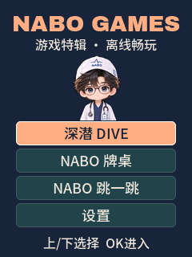
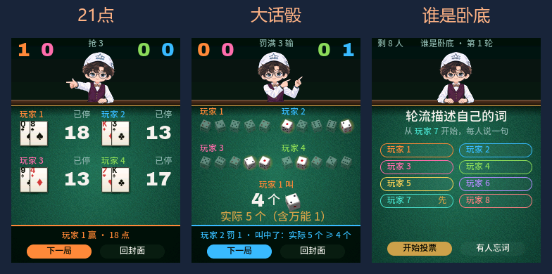

# NABO 游戏特辑

面向 FoloToy AI Passport（ESP32-C3 / 8 MB）的独立离线游戏固件。开机进入 NABO 游戏菜单，不需要配网、激活或小智服务。

**v1.0.0 已通过用户实机验收。** 实体按键、五种玩法、音效、长按退出、设置及自动休眠后按键唤醒均已确认正常。发布包使用同一份已验收应用，不重新编译。

[下载 v1.0.0](https://github.com/Liutupi/nabo-games/releases/tag/v1.0.0) · [安装说明](docs/INSTALL.md) · [验证记录](docs/VALIDATION.md)

封面为宣传插画。首页采用原有白大褂 NABO 半身像；牌桌对局中保留荷官造型，深潜与跳一跳保留各自的游戏造型。

## 内容

| 入口 | 内容 |
| --- | --- |
| 深潜 DIVE | NABO 深海下潜、换向、俯冲、氧气与深度纪录 |
| NABO 牌桌 | 21点和大话骰（2–4人）；谁是卧底（3–8人，264组词） |
| NABO 跳一跳 | 人体动作、连续蓄力、难度递增、迷你平台，以及咖啡杯/电脑/音箱/黑胶一人位平台 |
| 设置 | 音量、亮度、扬声器开关、自动休眠、电量和设备状态 |

小智语音、联网激活、Wi-Fi、蓝牙、电台和其他工具不包含在本合集内。游戏中的 NABO 形象、动画和音效保留。

应用约 2.46 MiB，所有游戏素材均嵌入应用。实机串口流程中的牌桌与后期一人位画面：

## 操作

- 首页：上/下选择，OK 进入。
- 深潜：OK 开始/换向，下键按住俯冲，上键单击暂停，长按上键返回首页。
- 牌桌：原有三种玩法和按键流程保留；对局中长按 OK 2 秒暂停并选回封面，在封面长按上键或双击上键返回首页。
- 跳一跳：按住 OK 蓄力、松开起跳；下键切换角色，长按下键重新开始，上键返回首页。
- 设置：上/下选项目，OK 编辑；上/下调整，OK 保存；编辑中长按上键取消本次调整。
- 自动休眠可设为关闭、30/60/120/300/600 秒。仅在按键全部松开后进入深睡，任意键唤醒后回到首页。

跳一跳前 7 跳保持原难度；约第 8 跳开始逐渐变难；约第 20 次成功落地后才会随机出现一人位小物，落点更窄，成功额外加 1 分。它们不是前几跳就固定出现的平台。

## 构建与验证

构建使用 ESP-IDF 6.0.2、LVGL 9.5.0，依赖版本由 `firmware/dependencies.lock` 锁定。Windows 可执行 `./build.ps1`。源自深潜独立版的 BSP 已补齐 IDF 6 的直接驱动依赖和 FreeRTOS 头文件；引脚不变。

源码位于 `firmware/main/`。三个游戏的来源、提交与复制时的 SHA256 见 [source-provenance.json](docs/source-provenance.json)。旧深潜 `main.c` 入口由 `collection_main.c` 替换。

宿主测试位于 `tests/`，覆盖实际生产 C 的规则、渲染、字体、音效和菜单设置；本版的自动检查及用户实机验收记录均已保存。见 [VALIDATION.md](docs/VALIDATION.md)。

## 升级边界

保留 NABO 定制版的分区边界：应用 `0x10000 / 0x3f0000`，资源 `0x400000 / 0x300000`，文件 `0x700000 / 0x100000`。合集素材全部嵌入应用，不读取或改写旧资源/文件分区。

**不要直接对已使用的设备执行 `idf.py flash` 或覆盖完整镜像。** 保留数据升级必须先确认设备身份、完整备份、核对实际分区，再仅写应用并验证保留区。首次完整安装会覆盖 NVS 区域里的设置和成绩。首次完整安装与保留数据升级的区别见 [安装说明](docs/INSTALL.md)。

## 许可与来源

- 合集代码、游戏代码：MIT，保留根目录 `LICENSE`、`LICENSE.Jump`、`LICENSE.Table` 与各源文件声明。
- 板级支持包：FoloToy，MIT，见 `firmware/LICENSE.FoloToy`。
- 字体：思源黑体、Archivo Black、Space Mono，OFL 1.1，许可证位于 `firmware/main/`。
- NABO 形象、牌桌精灵与其他美术不随源码 MIT 授权，见 [NOTICE.md](NOTICE.md)。
- 深潜来源：[Liutupi/nabo-dive](https://github.com/Liutupi/nabo-dive)。
- 牌桌来源：[Liutupi/ai-passport-nabo-xiaozhi-table v1.6.0](https://github.com/Liutupi/ai-passport-nabo-xiaozhi-table/tree/v1.6.0)。
- 优化跳一跳来源：[Liutupi/ai-passport-nabo-xiaozhi](https://github.com/Liutupi/ai-passport-nabo-xiaozhi)。
