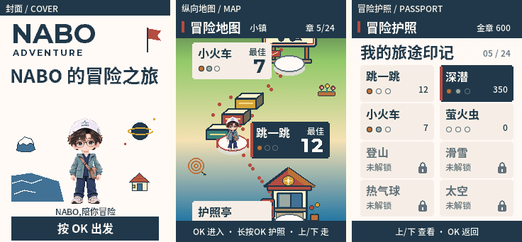

# 字体与界面精修复核 · 2026-10-25

用户反馈旧版整体字体“太单薄太土”。本次沿用已选的①复古护照手账方向，增强标题、品牌与数字的分量，减少土黄细框和装饰密度，拉开正文、标题与成绩的层级。保留已选旅行服 NABO 的原头脸、眼镜与帽标；此轮字体精修没有重画人物。

联系表为封面、地图、护照的实际生产 C 截图。每页保持原 240×320，不缩放、不重排屏内内容；仅在屏外增加 22px 标签条与 8px 间隔。三块屏幕区域已经逐像素比对各自原截图。

## 字体与落地方式

| 用途 | 字体 / 字重 | 实际字号与实现 |
| --- | --- | --- |
| 中文标题、站名、菜单与重点字段 | Noto Sans SC Bold，700，Version 2.002 | 16 / 18px；`lv_font_conv 1.5.3` 固定 4bpp 子集，生产 C 直接读字形 |
| 正文、说明、底栏与次要字段 | Source Han Sans CN Medium，500，Version 2.005 | 12px；同为固定 4bpp 子集 |
| 英文品牌与游戏英文名 | Montserrat Bold，700，Version 8.000 | 固定 PNG；封面 `NABO` 38px、`ADVENTURE` 12px / tracking 2，游戏英文名 14px / tracking 2 |
| 固定中文字标 | Noto Sans SC Bold，700 | 封面完整“NABO 的冒险之旅”与游戏名 26px，输出独立 PNG |
| 大成绩与 HUD 数字 | Montserrat Bold，700 | 20 / 36px 固定字形 PNG 与 advance 表 |

动态字库仍由原 4bpp 读取器绘制，没有把其他位深的字体交给旧读取器。`ag_text_top` 按实际字形 ascent 对齐文字墨迹上沿，避免换成粗体后沿用旧 baseline 造成卡片内距不齐。封面字标独立透明，封面背景、人物与字标保持可独立合成。版本号、电压等少数字段沿用既有 12px 等宽字体。

原字体文件已核对 fullname、版本、字重、SHA256 与 OFL 许可。当前 C 子集来源与输出哈希见 [collection-fonts.json](../firmware/tools/collection-fonts.json)，UI 固定字标的完整来源记录见 [fonts/sources.json](../game-art/adventure/art/ui/fonts/sources.json)。

| 原文件 | SHA256 |
| --- | --- |
| `C:/Windows/Fonts/Noto Sans SC Bold (TrueType).otf` | `d1961be1161ea1be08496c920862d06ea5c23a757628f4fd69368de1d9f51bed` |
| `D:/AI PASSPORT XIAOZHI/nabo-fortune/tools/fonts/SourceHanSansCN-Medium.otf` | `a94e558a2fe972bee4f46bce0843abff37063fd68c33f1e7d9058f6f09432b01` |
| `D:/AI PASSPORT XIAOZHI/table-undercover/repo/xiaozhi-esp32/managed_components/lvgl__lvgl/tests/src/test_files/fonts/Montserrat-Bold.ttf` | `06a0e623bbaf4a0237f1d605affa269f9e431ff50c7143dcbb47b815edaba9bd` |

完整许可保存在 [UI licenses](../game-art/adventure/art/ui/licenses/)；C 子集附带 [font-licenses](../firmware/main/font-licenses/)。`fonts/sources.json` 中的读取方式说明记录 UI 素材生成阶段；实际 C 子集转换记录以 `collection-fonts.json` 为准。

## 配色、留白与层级

- 基础纸色 `#fffaf0`，正文与选中实底为海军蓝 `#203849`，邮戳红 `#b64c43` 作为少量强调；次要文字 `#60707a`，中性卡面 `#f1eee5`。完整色值见 [palette.json](../game-art/adventure/art/ui/palette.json)。
- 选中菜单与当前站卡使用海军蓝实底、奶白文字，红色侧标作为补充。未选项保持浅卡面与深文字，弱化重复细边框；锁定状态保留明确文字与锁图标。
- 保持顶栏 32px、底栏 30px 与重要卡片至少 8px 内距。地图仍是上下键驱动的纵向世界路径；当前/邻站卡为 112×52，护照格为 104×52。
- 封面标题完整呈现“NABO 的冒险之旅”，没有孤立“的冒险之旅”或无产品含义的红色“01”。CTA 已落在 `(16,284)`，独立文案“NABO,陪你冒险”位于人物脚底与按钮之间。

## 实际审阅与修复

以下图片均由 [test_adv_renderer.py](../tests/test_adv_renderer.py) 编译生产 C 页面、生产字库与真实打包素材后，经模拟 240×320 面板输出。审阅时实际打开原生尺寸截图，检查了文字裁切、标题粗细、字距、卡内对齐与选中对比。

| 页 | 生产截图 |
| --- | --- |
| 封面 | [cover](images/ui/cover.png) |
| 纵向地图 | [map-town](images/ui/map-town.png)；另查 [深海](images/ui/map-sea.png)、[锁定站](images/ui/map-locked.png)、[太空](images/ui/map-space.png) |
| 冒险护照 | [passport](images/ui/passport.png) |
| 护照亭 | [kiosk](images/ui/kiosk.png) |
| 设置 | [settings](images/ui/settings.png) |
| 设备状态 | [status](images/ui/status.png) |
| 游戏标题 | [title](images/ui/title.png) |
| 准备 | [ready](images/ui/ready.png) |
| 占位玩法 / 资源 HUD | [play](images/ui/play.png) |
| 暂停 | [pause](images/ui/pause.png) |
| 结束 | [end](images/ui/end.png) |
| 结算 | [result](images/ui/result.png) |
| 印章仪式 | [银章](images/ui/stamp-silver.png)；同时检查 [铜章](images/ui/stamp-bronze.png)、[金章](images/ui/stamp-gold.png) |

本轮实际发现并修复了三项可见问题：

1. 银章等级文字使用浅银色时，在米白卡面上对比不足。三种等级名称统一用深墨色，印章图案保留对应金属色。[修正后银章](images/ui/stamp-silver.png) 已实看，等级文字区另有真实像素断言。
2. 护照把 uint32 最大纪录直接打印为十位数，会与三枚章重叠。护照及 36px 结算成绩沿用地图/HUD 的 `9999+` 上限显示；原纪录值与保存逻辑不变。[最大纪录边界图](images/ui/passport-max-records.png) 已实看，八张卡的数字与章槽分开；回归断言超限纪录使用相同的有界标记。
3. 锁定格被选中时，灰锁在海军蓝卡面上不够清楚。选中锁改用奶白色，未选中锁保持灰色。[锁定选中边界图](images/ui/passport-selected-locked.png) 已实看，锁区奶白像素另有断言。

两个边界截图由最终宿主输出原样复制到此目录，像素与私有原图一致：最大纪录 PNG SHA256 `f34a3fa84c3c7adb8cb5f1df6491922fecf25f26299fa3ed83c4f809b883fcc5`，选中锁 PNG SHA256 `cb0723d6b5a967b30392781ff117a264cf3f90960ae526d488ac30e55c8def46`。

## 验证范围

统一完整宿主门禁 **160 项通过**，包含 10 项生产页面 renderer 测试。页面门禁检查增量绘制与整屏一致、显示列表不溢出、随机导航，以及新增的等级文字、选中锁和极大纪录边界。此次文档整理直接使用该轮输出，没有重新构建或重跑测试。

新版开机演出另查看了 [2000ms](images/ui/boot-2000.png) 的挥手与 [5000ms](images/ui/boot-5000.png) 的中性末态；生产 renderer 断言选中演出中段确有变化、首尾回到同一中性图、4417/5000ms 保持一致。动作素材与音频的详细来源、预算由相应文档记录，此处只记录字体布局与实际截图复核。

本次复核时，新字体与新版演出的候选 app SHA256 为 `557607a2f468fed67f5e52adae2f008dd7b44fd5b9d52d94d16c72bb0fa97604`，尚未刷写。上述证据证明宿主生产 C 合成与界面可读性；实体屏幕观感、语音听感、按键、睡眠与唤醒仍待该候选真机验收。后续硬件状态以 [VALIDATION.md](VALIDATION.md) 为准，先前版本的真机通过不计作这份候选的验收。

后续本镜像已保护式上机。用户确认新字体/欢迎“都正常”，本次30秒熄屏/上键恢复通过。新封面实际设备输出与宿主76,800像素完全一致，99分/3章存档逐字节保留；以VALIDATION最新用户确认节为当前状态。
