# 界面设计

版本 0.1 · 2026-10-25

第 1–6 节描述**现在的占位版式**（东西放在哪、怎么操作），第 7 节是**界面视觉设计的要求**（交给美术，界面最终长什么样）。

下面的截图都由 `tests/test_adv_renderer.py` 用**生产 C 代码**渲染（宿主机模拟 240×320 面板），不是效果图。改界面后跑这个测试，`docs/images/ui/` 会更新。现在全部用形状和文字占位；NABO 精灵、地标和图块到位后替换对应部分（见第 5 节）。

## 1. 基本约束

- 屏幕 240×320 竖屏，RGB565。大面积渐变一律用 `ag_band`（4×4 有序抖动），不要用单色阶梯。
- 按键只有 上 / 下 / OK，每个画面的底栏都写清楚当前能按什么。
- 中文只能用 18 / 16 / 12 三个字号（思源黑体 Medium，子集字库）。新增中文字后必须重新生成字库（`firmware/tools/generate_collection_fonts.py`），否则显示缺字。宿主测试会检查所有 `adv_*.c` 里的中文都有字形。
- 海报体 Archivo Black 28 号只有大写字母、数字和少量符号；48 号**只有数字和 `!%ABCDEISV`**，只能用来写数字。

## 2. 配色（`adv_ui_internal.h`）

| 名字 | RGB565 | 约等于 | 用途 |
|---|---|---|---|
| INK | `0x1927` | #182439 | 夜蓝：浅底上的字、顶栏底栏、卡片描边 |
| PAPER | `0xef3b` | #EEE6DE | 纸色：深底上的字、卡片底 |
| GOLD | `0xfd70` | #FFAD84 | 选中、标题、NABO 位置牌 |
| WHITE | `0xffff` | #FFFFFF | 大标题、成绩 |
| DIM | `0x7bef` | #7B7D7B | 次要说明、空章圈 |
| LOCK | `0x7bd1` | #7B798C | 未解锁 |
| RED | `0xe28a` | #E65152 | 资源不足、失误 |
| 铜 / 银 / 金章 | `0xcbe6` / `0xc639` / `0xfe69` | #CD7D31 / #C5C6CD / #FFCE4A | 三档印章 |

每个站点还有一个世界色（`adv_stations.c` 的 `color`），用于地图节点、资源条和游戏背景。

## 3. 通用部件

| 部件 | 位置 | 说明 |
|---|---|---|
| 顶栏 | y 0–32 | INK 半透明；左边标题（16 号），右边 “章 n/24”（金色） |
| 底栏 | y 290–320 | INK 半透明；居中操作提示（12 号） |
| 印章点 | — | 三个圆：拿到的填铜/银/金色加深色描边，没拿到的只有灰圈 |
| 菜单卡 | 宽 180–208 | 圆角 10；选中填 GOLD 加 2 px 描边 |
| 游戏顶栏 | y 0–34 | 资源名（12 号）+ 资源条（x 40–164）+ 右侧成绩（Archivo 28） |
| 弹出卡 | 宽 192 | 背后整屏压暗（INK 150/255），卡片 PAPER 圆角 14 |

## 4. 画面

### 封面、地图

| 封面 | 地图·小镇 | 地图·深海 | 地图·没解锁 | 地图·太空 |
|---|---|---|---|---|
|  |  | 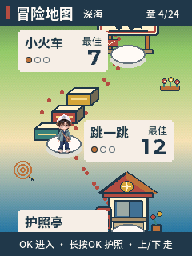 | 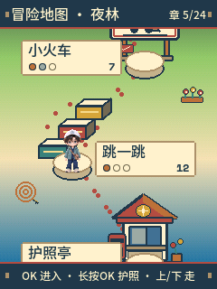 | 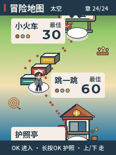 |

- 封面：上半夜空到暮色，中间圆框里是已有的白大褂 NABO 半身像，底部 “按 OK 出发”。
- 地图：站点间距 112 px，左右交替（x = 80 / 160），白点虚线连路径。站点圆半径 17，里面是编号（护照亭写“护”，没解锁写“?”）；旁边一张名字卡（名字、三枚章、最佳成绩）。NABO 所在站点有金色光晕、外圈和 “NABO” 位置牌。
- 地面颜色按世界从下到上：深海蓝 → 港口青 → 小镇米黄 → 平原绿 → 夜林墨绿 → 雪山灰蓝 → 雪坡白 → 天空蓝 → 太空深紫。

### 护照亭、护照、盖章

| 护照亭 | 护照 | 铜章 | 银章 | 金章 |
|---|---|---|---|---|
| 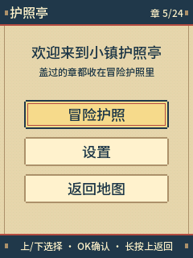 |  |  | 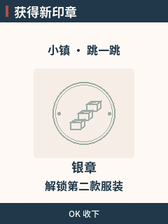 | 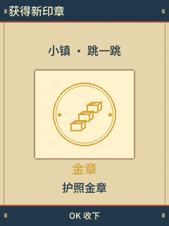 |

- 护照：2 列 × 4 行，每格一个游戏：世界色竖条、名字、三枚章、最佳。底部一行写选中游戏离下一枚章还差多少。
- 盖章：大印章（半径 60）+ 光晕，印章里写游戏英文名，下面写这枚章解锁了什么。

### 外壳游戏的一局（现在是占位关卡）

| 标题 | 准备 | 进行中 | 暂停 | 结束 | 结算 |
|---|---|---|---|---|---|
|  | 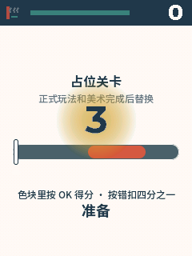 | 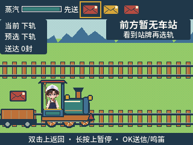 | 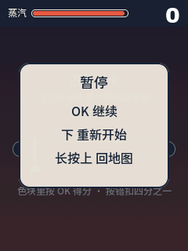 | 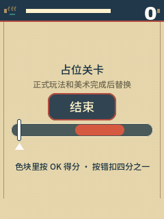 |  |

- 标题：世界名、英文名（Archivo 28）、中文名、三枚章和各自门槛、最佳。
- 准备：48 号倒数数字 + 金色光晕。
- 结算：本局成绩（48 号）、新纪录标签、最佳、三枚章。

### 设置、状态、跳一跳

| 设置 | 状态 | 跳一跳（旧游戏，原样保留） |
|---|---|---|
| 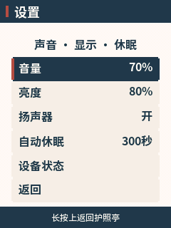 | 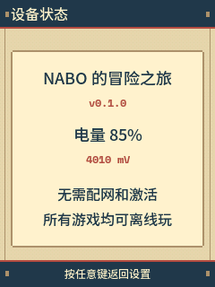 | 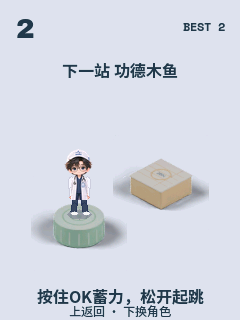 |

## 5. 美术到位后要替换的

| 占位 | 换成 | 美术规格 |
|---|---|---|
| 地图上的 “NABO” 位置牌 | NABO 走路 / 待机精灵（基础服装） | ART_BRIEF 3.1 |
| 站点圆 + 编号 | 每站一个地标（≤ 96 px） | ART_BRIEF 4.2 |
| 地面渐变 | 渐变 + 32×32 图块装饰（海浪、屋顶、铁轨、树、雪、云、星） | ART_BRIEF 4.1 |
| 盖章页的圆形印章 | 每站一枚印章图（三档换色） | ART_BRIEF 5 |
| 结算页 | 加 NABO 穿该游戏服装的欢呼动作 | ART_BRIEF 3.2 |
| 占位关卡 | 正式游戏画面 | GAMES.md |
| 纯色圆角卡片、顶栏底栏 | 九宫格边框和装饰 | 本文 7.3 |
| 封面标题文字和圆框 | 封面插画 + 标题字标 | 本文 7.2 |
| 游戏标题页的英文名 + 中文名 | 每个游戏的标题字标 | 本文 7.2 |
| 护照的格子 | 护照内页样式 | 本文 7.4 |
| 结算页的成绩数字、“新纪录”标签 | 数字图 + 标签图 | 本文 7.5 |
| 地图上的站点圆、路径白点 | 站点底座、脚印 | 本文 7.6 |

## 6. 新游戏画面的规矩

- 游戏只画 y 34–320 的游戏区；顶栏和所有弹出卡由外壳画。
- 游戏区底部 30 px 在标题和结算时会被底栏盖住，进行中可以用。
- 重要的东西别放在 y 34–60（顶栏阴影区）。
- 每帧只改变真正动了的东西，让脏矩形保持小；动的精灵越少越好。

## 7. 界面视觉设计要求（给美术）

占位版式只定了位置和交互。界面最终的样子由美术设计，按下面的要求交付。素材放 `game-art/adventure/art/ui/`。

### 7.1 风格方向

- 主题是“**旅行手账 + 冒险护照**”：盖章、邮票、票根、手写标签、纸张、缝线这类元素，配合 NABO 的平涂加两阶阴影画风。
- 画风和角色一致：平涂、两阶赛璐珞阴影、深色描边，不要拟物写实，不要软 3D，不要大面积渐变和纸张噪点纹理（RGB565 下会变脏、出色带）。
- 每个世界有自己的配色（地图上从深海到太空），但界面部件（卡片、按钮、栏）是**同一套**，只在点缀色上随世界变化。
- 小屏可读性第一：240×320 上，最小的字是 12 号，图形细节不要小于 2 px。
- 第一步先出**风格板**：2–3 个方向，每个方向在 1 倍尺寸下画出 地图、护照、游戏标题、结算 四个画面的完整效果图，由用户选定后再做全套素材。方向参考：① 复古护照手账（米黄纸色、深蓝墨、邮戳红）② 明亮童趣贴纸（高饱和、白描边贴纸感，注意 NABO 本身不能用白描边）③ 星图夜航（深蓝底、金色细线、星点）。

### 7.2 封面与标题

| 素材 | 尺寸 | 颜色 | 说明 |
|---|---|---|---|
| 封面插画 | 240×320 整屏 | ≤ 64 色 | NABO 穿基础旅行服，背景是冒险地图的缩影（海、小镇、雪山、太空）。底部 y 270–320 留给“按 OK 出发”按钮，不放重要内容 |
| 合集标题字标 | ≤ 220×90 | ≤ 16 色 | “NABO ADVENTURE”+“NABO 的冒险之旅”，放在封面上方 |
| 游戏标题字标（8 个） | ≤ 200×80 | ≤ 16 色 | 每个游戏的中文名 + 英文名，风格统一、按世界换点缀色；用在游戏标题页 |

字标里的文字是固定的，可以画成图；**其他会变化的文字（成绩、提示、名字）一律由程序用字库写**，不要画进图里。

### 7.3 通用部件（九宫格）

卡片和栏要能被程序拉伸成不同大小，所以用**九宫格**交付：四个角各一块、四条边各一块（可平铺）、中间一块（可平铺或纯色）。

| 部件 | 角块尺寸 | 状态 | 用在 |
|---|---|---|---|
| 菜单卡 | 12×12 | 普通、选中、不可用 | 护照亭菜单、设置 |
| 信息卡 | 12×12 | 普通、当前 | 地图上的站点名字卡、护照格子 |
| 弹出卡 | 16×16 | 一种 | 暂停、结算 |
| 顶栏 | 高 32 | 一种 + 可选左右装饰（≤ 32×32） | 所有外壳页面 |
| 底栏 | 高 30 | 一种 | 所有外壳页面 |
| 资源条 | 高 10，左右端头 + 可平铺中段 | 外框、填充、低于 25% 的填充 | 游戏顶栏 |

- 选中状态要和普通状态一眼区分开（不能只靠细微色差）。
- 九宫格的边和中间必须能无缝平铺。

### 7.4 冒险护照

- 护照页面做成真护照内页的感觉：页面底纹（可平铺的小图块，≤ 32×32，≤ 8 色）、页眉装饰。
- 每个游戏一格（现在 2 列 × 4 行，每格约 104×52）：格子边框、三枚章的空位（章印用 ART_BRIEF 第 5 节的印章缩小版或单独的 12×12 小章）。
- 没解锁的格子要有“未解锁”的样式（例如盖着封条），由美术设计一个可叠加的遮罩块。

### 7.5 数字和标签

- **大数字**：成绩和倒数用，0–9 十个字形 + “m” “+”，两种尺寸：高 36 px（结算、倒数）和高 20 px（游戏顶栏）。和标题字标同一风格，≤ 8 色。
- **标签**：“新纪录”“测试不记录”“占位关卡”三个，≤ 100×24。
- **印章仪式**：盖章时的冲击效果由程序做（缩放、光晕），美术只需提供章的图（ART_BRIEF 第 5 节）和一张“印泥”底纹（≤ 64×64）。

### 7.6 地图上的界面元素

| 素材 | 尺寸 | 说明 |
|---|---|---|
| 站点底座 | ≤ 48×48 | 三种状态：已解锁、未解锁、当前站（当前站外圈要醒目）。地标（ART_BRIEF 4.2）站在底座上 |
| 路径脚印 | ≤ 10×10 | 代替现在的白点，正反两种朝向 |
| NABO 位置标 | ≤ 32×20 | 只在 NABO 精灵完成前临时用；精灵完成后由精灵代替 |
| 锁 | ≤ 16×16 | 未解锁站点的图标 |

### 7.7 资源图标

ART_BRIEF 第 5 节的 7 个资源图标（16×16）和界面同一风格交付。

### 7.8 硬性约束

- 所有界面部件共用**一套调色板，≤ 32 色**（封面插画、字标可以各自另用调色板）。风格板阶段就要给出这套调色板。
- 1 倍像素交付，PNG，透明背景；不要先画大再缩小。
- 每样素材在实际背景色上做一张预览，放 `art/ui/preview/`。
- 文字区域留够空间：中文字 12 / 16 / 18 号，单行高分别约 15 / 19 / 22 px；卡片内边距 ≥ 8 px。
- 安全区：顶栏 0–32、底栏 290–320 由外壳占用；游戏画面只用 34–290。
- 总量：界面包（含封面、字标、九宫格、数字、标签、地图元素）合计 ≤ 160 KiB（打包后），见 BUDGET.md。

### 7.9 程序这边要配合做的

- `adv_gfx` 新增九宫格操作（四角 + 平铺边 + 中间）和精灵操作 `AG_SPRITE`。
- 数字精灵字体：按字形宽度排版，替换 Archivo 数字。
- 打包脚本把 `art/ui/` 打进固件，并检查调色板不超过 32 色。

### 7.10 验收

- [ ] 用户选定了风格板方向和调色板。
- [ ] 每个画面换上新素材后，在真机或宿主渲染截图里对比：文字清楚、选中状态明显、没有色带和脏点。
- [ ] 九宫格拉到最小（48×32）和最大（240×120）都不变形。
- [ ] 界面调色板 ≤ 32 色，界面包 ≤ 160 KiB。

## 2026-10-26 用户更新后的开机V3

用户明确否定原小人物/杂乱元素、白底留白与骨骼硬片，指定参考赛博算命机和声音实验室。开机改为大NABO、深靛蓝遗迹与聚焦罗盘，字标位于下部；其它地图/护照/游戏页面继续选定复古手账风格。Grok只补BOOT-V3-01表演，原始身份与帽标不改。

本V3为独立视频档：完整RGB565主视觉经208×272 I/P视频、整数行采样输出240×320，固定口号/OK由原生12px字库叠加。RLE资产的≤64色契约保持；此视频档不再重复量化成64色，费用全部计入224KiB开机+UI额度。增加64KiB由旧字库未用字形无损回收支出，352KiB永久保留额不动。实际合计226,733B。技术候选、宿主图和真机验收必须分开记录。
